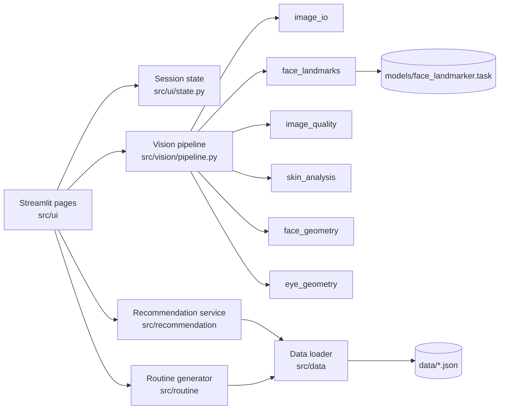

# The Beauty Studio — AI Virtual Makeup Artist

**A Vision-Based Cosmetic Recommendation and Personalized Makeup Expert System**

> **Project status:** Release 1.0 implemented and verified locally (Windows, Python 3.11.9). **Not yet deployed.** See [§29 Project status](#29-project-status-and-acceptance-criteria) for exactly what was verified.

---

## 1. Overview

The Beauty Studio is a Streamlit web application with two workflows:

| Workflow | What it does |
|---|---|
| **A — Discover My Shades** | Analyzes a single face photo (upload or camera) to *estimate* visible skin depth, a possible undertone, eye shape/tilt and approximate face shape, lets the user review and correct those estimates, and ranks catalog shades for foundation, concealer, color corrector, lipstick, blush and eyeliner with an explanation for every result. |
| **B — Create My Makeup Routine** | Takes the products the user actually owns (catalog or custom entries) and a desired look (Everyday, Office, Festive, Glam) and produces a numbered, dependency-ordered routine that only uses those products. |

All computation is local and deterministic: classical image processing (OpenCV, NumPy, scikit-learn) on top of MediaPipe Face Landmarker landmarks, and explicit rule-based expert systems for ranking and routine generation. No LLM or paid API is used at runtime.

## 2. Problem statement and motivation

Choosing complexion shades and building a makeup routine is difficult: shade ranges are large, undertone vocabulary is inconsistent between brands, and generic tutorials assume products the user may not own. Most consumer "AI shade match" tools are opaque about how they reach a result and rarely say when a photo is unsuitable.

This project explores a **transparent** alternative: every estimate carries an explicit status (`unknown`, `uncertain`, `estimated`, `user_confirmed`), unreliable images are rejected rather than guessed at, every recommendation lists the criteria that produced it, and every routine step references a product the user actually has.

## 3. Objectives

1. Extract facial landmarks from a single photo and validate them before use.
2. Estimate visible skin depth and undertone with documented heuristics and explicit uncertainty.
3. Estimate eye shape, eye tilt and approximate face shape from normalized geometric ratios.
4. Let users confirm or correct every estimate, or enter their profile manually without a photo.
5. Rank catalog shades with category-specific, documented scoring and human-readable explanations.
6. Generate inventory-aware, dependency-ordered makeup routines from explicit rules.
7. Deliver a polished, accessible, privacy-respecting web experience.

## 4. Target users and use cases

- **Makeup beginners** who want a starting point for shade families and an ordered routine.
- **Users with an existing collection** who want to know how to combine what they own for a specific occasion.
- **Students / evaluators** studying explainable computer-vision and expert-system design.

Use cases: estimate my complexion profile from a selfie; browse ranked shades for a category; set my profile manually and browse; build a festive routine from five products I own; learn eyeliner technique suited to my eye shape.

## 5. Features

### 5.1 Face Analysis (Workflow A)
- Upload (JPEG/PNG/WebP, ≤ 10 MB) or camera capture; the upload option is always available.
- Validation of format, size, decodability, dimensions and pixel count.
- Single-face requirement: no-face and multiple-face images are rejected with guidance.
- Quality checks: sharpness, exposure/clipping, lighting balance across cheeks, face size, head pose (yaw/roll).
- Estimates: skin depth (6 levels), undertone (cool/neutral/warm), eye shape (almond/round/hooded), eye tilt (upturned/neutral/downturned), face shape (oval/round/square/heart/oblong).
- Every feature reports a status; ambiguous features list candidate values instead of forcing a category.
- Correction controls for every feature (including values the analyzer never auto-assigns, such as *monolid*).
- A sampling-region overlay so users can see which pixels were measured.

### 5.2 Shade Finder (Workflow A)
- Category tabs for foundation, concealer, color corrector, lipstick, blush and eyeliner, each with category-specific filters.
- Hard compatibility filters kept separate from soft ranking preferences.
- Product cards with brand, product, shade, finish, coverage and data-provenance badge; price/links are shown only when verified (the bundled demo catalog has none).
- A per-result explanation and expandable score breakdown.
- Empty states that explain *why* nothing matched; essential filters are never silently relaxed.
- Foundation shade verification disclaimer.

### 5.3 My Makeup Routine (Workflow B)
- Inventory management: add from catalog (with shade), add custom products, edit, remove.
- Look selection and optional preferences (coverage, intensity, concealer order).
- Numbered steps with product, purpose, technique, feature-specific tips, optional status, compatibility notes (metadata-backed only) and cautions.
- Skipped-step explanations and clearly labelled optional suggestions for products the user does not own.

### 5.4 Home and About & Methodology pages
Editorial landing page and a concise engineering explanation for evaluators.

## 6. Functional requirements

| ID | Requirement |
|---|---|
| FR-001 | The system shall accept image uploads in JPEG, PNG or WebP format up to 10 MB. |
| FR-002 | The system shall offer camera capture and keep upload available when the camera is unavailable or denied. |
| FR-003 | The system shall reject images that fail decoding, exceed 40 megapixels, or have a shorter side below 256 px, with a specific message. |
| FR-004 | The system shall require exactly one detected face; zero or multiple faces produce a specific, non-fabricated error. |
| FR-005 | The system shall assess image quality (sharpness, exposure, clipping, lighting balance, face size, head pose) and report each check. |
| FR-006 | The system shall extract MediaPipe Face Landmarker landmarks and validate count, finiteness, bounds and non-degenerate geometry before measurement. |
| FR-007 | The system shall estimate visible skin depth from multi-region skin samples and report `uncertain` near category boundaries or under poor quality. |
| FR-008 | The system shall estimate a possible undertone and report `uncertain` when the hue is near a boundary, regions disagree, or a color cast is suspected. |
| FR-009 | The system shall estimate eye shape and eye tilt from multiple normalized measurements, never from a single aspect ratio. |
| FR-010 | The system shall estimate approximate face shape from multiple normalized ratios and report `uncertain` when the best two categories are close. |
| FR-011 | Analysis output shall follow a validated schema distinguishing `unknown`, `uncertain`, `estimated` and `user_confirmed` values, with warnings and measurement metadata. |
| FR-012 | Users shall be able to confirm or correct every estimated feature. |
| FR-013 | Users shall be able to enter a profile manually without uploading a photo. |
| FR-014 | The system shall load products, shades and tutorial rules from JSON and validate schema, enums, unique IDs and cross-references at startup. |
| FR-015 | The system shall rank foundation shades by depth, undertone, finish and coverage compatibility. |
| FR-016 | The system shall rank concealer shades by depth relative to purpose (brightening vs. spot), undertone and finish. |
| FR-017 | The system shall rank color correctors by correction target and depth suitability. |
| FR-018 | The system shall rank lipsticks by look, color family, intensity and finish. |
| FR-019 | The system shall rank blushes by look, color family, intensity and formulation. |
| FR-020 | The system shall rank eyeliners by look, color and liner type and show eye-shape technique guidance. |
| FR-021 | Ranking shall use an explicit weighted score in [0, 1] with a visible breakdown; it is not presented as a probability. |
| FR-022 | Each recommendation shall include an explanation generated only from the criteria that were evaluated. |
| FR-023 | When no candidate passes essential filters, the system shall say so, suggest adjustments, and not invent or silently relax matches. |
| FR-024 | Users shall be able to add catalog products (and a shade where applicable) to an inventory. |
| FR-025 | Users shall be able to add custom products absent from the catalog. |
| FR-026 | Users shall be able to edit and remove inventory items. |
| FR-027 | Users shall select one look (Everyday, Office, Festive, Glam) and optional preferences. |
| FR-028 | The system shall generate a numbered routine whose every step references an inventory item. |
| FR-029 | Step order shall come from a dependency-aware topological sort over conditional constraints, with cycle detection. |
| FR-030 | Missing categories shall be skipped; suggestions for unowned products are clearly labelled optional and never numbered steps. |
| FR-031 | Routines shall include face/eye-feature tips only for features that are `estimated` or `user_confirmed`. |
| FR-032 | Tutorial rules shall be validated for duplicate IDs, unknown references and contradictory equal-priority instructions. |
| FR-033 | The application shall provide Home, Face Analysis, Shade Finder, My Makeup Routine and About & Methodology pages with consistent navigation. |
| FR-034 | Per-user state shall live only in the Streamlit session; changing or clearing the image shall invalidate dependent results. |
| FR-035 | The UI shall display estimate, foundation-verification and demonstration-catalog disclaimers. |

## 7. Non-functional requirements

| ID | Requirement |
|---|---|
| NFR-001 | Core functionality requires no paid service, LLM, account or database server; logic is deterministic. |
| NFR-002 | Images are processed in memory, never written to disk, never logged; derived overlays live only in the session and are cleared on reset. |
| NFR-003 | Uploaded data and filenames are treated as untrusted; decompression-bomb limits are enforced. |
| NFR-004 | A single analysis should complete in under 5 s on a typical laptop CPU after model load (target; measured value recorded in `docs/TEST_PLAN.md`). |
| NFR-005 | Text meets WCAG 2.1 AA contrast (≥ 4.5:1 for body text); inputs have labels; status is never conveyed by color alone. |
| NFR-006 | Pages are usable at laptop (≈1366 px), tablet (≈768 px) and mobile (≈390 px) widths. |
| NFR-007 | Code is modular, type-hinted, documented, and passes `ruff check`. UI modules contain no business logic. |
| NFR-008 | Dependencies are pinned; Python 3.11 is the documented runtime. |
| NFR-009 | Unit tests run without a webcam; model-dependent tests skip with an explicit reason if the model asset is absent. |
| NFR-010 | The app degrades gracefully when the model asset, web fonts or camera are unavailable. |
| NFR-011 | No fabricated confidence percentages, accuracy figures, product data or results. |
| NFR-012 | Only project-relative paths are used; no absolute local paths. |

## 8. Technical stack

| Technology | Role | Justification |
|---|---|---|
| Python 3.11 | Runtime | Supported by every dependency below and by Streamlit Community Cloud; verified locally (3.11.9). |
| Streamlit | Web UI | Pure-Python multipage UI with `st.navigation`, camera input and session state; no separate frontend build. |
| MediaPipe Face Landmarker | 478 facial landmarks + blendshapes | Maintained, CPU-friendly, Apache-2.0 model; avoids training a model. |
| OpenCV (headless) | Color conversion, masks, blur metric | Standard, fast, well-documented CIELAB conversion. |
| NumPy | Numerics | Vectorized geometry and statistics. |
| scikit-learn | K-Means | Exploratory dominant-color check on skin samples (diagnostic only). |
| Pillow | Decoding / validation | Safe format identification, EXIF orientation, decompression-bomb guard. |
| pytest | Tests | Fixtures, parametrization, Streamlit `AppTest` smoke tests. |
| ruff | Lint | Fast, single-tool linting. |
| JSON | Knowledge base | Human-readable, versionable; validated in code — no database server needed. |

Exact pinned versions are listed in `requirements.txt`.

## 9. System architecture



Layers: **UI** (rendering, widgets) → **services** (vision pipeline, recommendation, routine) → **core** (schemas, enums, errors) and **data** (validated knowledge base). The UI never performs image math, scoring or ordering. See `docs/architecture.md`.

## 10. Data flow

1. User uploads/captures an image → bytes validated (`image_io`) → decoded to an RGB array, EXIF-oriented, downscaled to ≤ 1280 px.
2. Face Landmarker runs (IMAGE mode, up to 2 faces to detect multi-face input) → exactly one face required.
3. Landmarks validated → quality checks → skin sampling → depth/undertone; geometry → eye and face estimates.
4. An `AnalysisResult` (no image pixels except an optional small overlay) is stored in session state with the image fingerprint.
5. User confirms/corrects → `UserProfile`.
6. Shade Finder: `UserProfile` + category preferences → hard filters → weighted ranking → explanations → product cards.
7. Routine: inventory + look + preferences (+ profile features if available) → rule selection → conditional ordering constraints → topological sort → numbered `Routine`.

## 11. Computer-vision methodology

MediaPipe Face Landmarker (float16 model) returns 478 normalized 3-D landmarks and 52 blendshape scores. Landmarks are converted to pixel coordinates; head roll is computed from the eye-centre line and removed before angular measurements. Yaw is approximated from the nose-tip-to-face-edge distance ratio. The pipeline never trains a model. Full detail: `docs/methodology.md`.

## 12. Skin-color estimation — method and limitations

1. **Regions:** left cheek, right cheek and forehead discs anchored to landmarks and scaled by inter-ocular distance, intersected with the face-oval hull, minus dilated eye, eyebrow and lip polygons.
2. **Pixel filtering:** near-clipped pixels removed; per-region L\* 10th–90th percentile trimming removes highlights and shadows.
3. **Color space:** sRGB → CIELAB (D65) via OpenCV float conversion.
4. **Robust statistics:** per-region medians; regions whose median differs from the cross-region median by ΔE\*ab > 15 are excluded as possibly obstructed (hair, hands, glasses). At least two regions must remain.
5. **K-Means (k = 3, fixed seed):** diagnostic only — warns when the dominant cluster centre diverges from the median (ΔE > 8). K-Means does **not** assign depth or undertone.
6. **Depth:** Individual Typology Angle, ITA° = atan2(L\* − 50, b\*)·180/π, mapped to six levels (fair > 55°, light 41–55°, medium 28–41°, tan 10–28°, deep −30–10°, rich < −30°), following the categories of Chardon et al. (1991) / Del Bino et al. (2006). Within ±3° of a boundary → `uncertain` with both candidates.
7. **Undertone:** CIELAB hue angle h = atan2(b\*, a\*). Heuristic bands: h < 52° cool-leaning, 52–60° neutral, > 60° warm-leaning, ±2° → `uncertain`. Also `uncertain` if a color cast is suspected (gray-world check on pixels outside the face: mean |a\*| > 10 or |b\*| > 15), regions disagree (hue spread > 8°), or any skin-relevant quality check warns.

**Limitations:** ITA was defined for calibrated colorimeter readings on skin, not uncalibrated phone photos; white balance, exposure, makeup, screen and camera processing all shift values. Undertone bands are **heuristics not validated against a labelled dataset**. Results are estimates for browsing, not shade matches. Olive undertones are not modelled.

## 13. Face and eye geometry — method and limitations

- **Face:** length (landmark 10→152), forehead width (54↔284), cheekbone width (234↔454), jaw width (172↔397) and chin angle at 152. Ratios normalized by cheekbone width are scored against trapezoidal membership rules for oval, round, square, heart, oblong; a best-vs-second margin below 0.15 → `uncertain` with both candidates.
- **Eye:** per eye width (corner to corner), vertical openings at three positions normalized by width, taper (end openings vs. centre), roll-corrected canthal tilt, and brow-to-lid distance as a weak proxy for visible lid space. Closed/blinking eyes (blendshape `eyeBlink*` > 0.5 or opening < 0.12) → `unknown`. Left/right disagreement → `uncertain`.
- **Limitations:** landmark 10 lies below the hairline, so face length is relative; the mesh does not model eyelid creases, so *monolid* is never auto-assigned and *hooded* is a weak proxy; thresholds are provisional and not validated on a labelled dataset; strong yaw/pitch invalidates geometry (checked) and expressions affect it.

## 14. Product knowledge-base schema

- `data/products.json` — products: `product_id`, `brand`, `product_name`, `category`, `finish`, `coverage`, `formulation`, `base`, `intended_use`, `price`/`currency`/`product_url` (nullable, verified only), `source`, `verification_status` (`verified` \| `unverified` \| `demo`), `shade_ids`.
- `data/shades.json` — shades: `shade_id`, `product_id`, `shade_name`, `depth`, `undertone`, `color_family`, `intensity`, `finish`, `correction_target`, `suitable_depths`, `suitable_looks`, `illustrative_swatch_hex` (demo only), `source`, `verification_status`.
- `data/tutorial_rules.json` — steps, technique rules, feature tips, cautions and conditional ordering constraints.

**Catalog decision:** official brand pages checked during development did not expose per-shade depth/undertone metadata in a verifiable, fetchable form, and inferring it would violate the "no fabricated product data" rule. The bundled catalog is therefore a **clearly labelled fictional demonstration catalog** (fictional brands *Atelier Demo* and *Lumen Demo*, `verification_status: "demo"`, no prices, no URLs). The UI badges every demo item. The schema and engine support `verified` real entries with provenance; `unverified` metadata is never used as a hard match. See `docs/limitations.md`.

## 15. Recommendation and ranking methodology

`score = Σ wᵢ·sᵢ` with category-specific weights summing to 1, each component `sᵢ ∈ [0, 1]`:

| Category | Hard filters | Weighted components |
|---|---|---|
| Foundation | user depth available (else "needs input"); shade depth listed and within 1 level; cool↔warm excluded | depth 0.45 · undertone 0.30 · finish 0.15 · coverage 0.10 |
| Concealer | as foundation; brightening = same depth or one lighter | depth-for-purpose 0.45 · undertone 0.25 · purpose 0.20 · finish 0.10 |
| Color corrector | correction target matches | target 0.60 · depth suitability 0.40 |
| Lipstick | — | look 0.35 · color family 0.30 · intensity 0.20 · finish 0.15 |
| Blush | — | look 0.35 · color family 0.30 · intensity 0.20 · formulation 0.15 |
| Eyeliner | — | look 0.40 · color 0.35 · liner type 0.25 |

Missing shade metadata scores 0 for that component (never rewarded); an unspecified user preference scores 0.5 for every candidate (non-discriminating). Ties break by product and shade ID. Scores are shown as a *fit score*, explicitly not a probability. Full definitions: `docs/methodology.md`.

## 16. Routine generation methodology

1. Validate inventory and look. 2. Select step definitions for categories present in the inventory and applicable to the look. 3. Evaluate conditional ordering constraints (e.g. cream blush before powder, powder blush after; concealer before or after foundation by preference; glam: eyeshadow before foundation for fallout clean-up). 4. Topologically sort with Kahn's algorithm, tie-broken by canonical sequence and step ID; cycles raise an error. 5. Attach technique by formulation, look modifiers, feature tips (estimated/confirmed features only), metadata-backed compatibility notes and cautions. 6. Report skipped steps and labelled optional suggestions.

## 17. Website pages and design system

Pages: **Home**, **Face Analysis**, **Shade Finder**, **My Makeup Routine**, **About & Methodology**, via `st.navigation` top navigation.

A new browser session first sees a full-screen **welcome screen**: the photograph `assets/welcome_beauty_studio.png` as background, with the brand title, tagline and a *Get Started →* button, and no navigation menu. Entering opens Home; the welcome screen is not shown again for that session (`src/ui/pages/welcome.py`, session key `bs_entered`).

| Token | Value | Use |
|---|---|---|
| Background | `#FFF9F6` | Page |
| Card | `#FFFFFF` | Cards |
| Dusty rose | `#C9828E` | Decorative accents, rules, highlights (2.97:1 with white — never used for text) |
| Muted mauve | `#8F6579` | Primary buttons/links (white text 4.88:1, AA) |
| Deep plum | `#352630` | Primary text (13.68:1 on ivory) |
| Warm gray | `#81747A` | Large/decorative secondary text only (4.27:1 on ivory) |
| Warm gray (text) | `#74676D` | Small secondary text (5.16:1 on ivory, AA) — darkened variant for accessibility |
| Soft blush | `#F0E1E2` | Borders |

Typography: Playfair Display (headings) and Inter (body) from Google Fonts, falling back to Georgia/serif and system sans-serif if unavailable. Shared CSS in `assets/styles.css`; reusable components in `src/ui/components.py`.

## 18. Privacy and security

- Images are processed in memory and never written to disk or logs; only a fingerprint (SHA-256) and derived numbers are kept in the session, plus a downscaled overlay that is cleared on reset or new upload.
- No accounts, no identity recognition, no analytics, no third-party API calls. Outbound requests: Google Fonts CSS (browser side) and a one-time model download if the model file is absent (can be disabled).
- File type is determined from content, not filename; filenames are never used for paths or shown unescaped.
- Pillow decompression-bomb limit and explicit pixel caps.
- No secrets are required; `.env` and model files are git-ignored.

## 19. Error handling and accessibility

Typed errors (`ImageValidationError`, `FaceDetectionError`, `ModelUnavailableError`, `CatalogError`, `RoutineError`) carry a user-facing message and are rendered via shared error components; unexpected exceptions are logged (without image data) and shown as a generic message. Accessibility: AA contrast, labelled widgets, text status labels in addition to color, semantic headings, alt text for overlays.

## 20. Testing and evaluation

pytest suite covering image handling, vision (synthetic landmarks/images), catalog validation, recommendation, routine engine, session-state and Streamlit `AppTest` page smoke tests; plus ruff, compile checks, data validation script, startup check and manual browser checks at three viewport widths. **No accuracy figures are claimed**: there is no labelled evaluation dataset. See `docs/TEST_PLAN.md`.

## 21. Directory structure

```
.
├── app.py                     # Entry point: page config, theme, navigation
├── requirements.txt           # Pinned runtime dependencies
├── requirements-dev.txt       # Test/lint tools
├── pyproject.toml             # pytest + ruff configuration
├── packages.txt               # System packages for Streamlit Community Cloud
├── .streamlit/config.toml     # Theme and server settings
├── assets/styles.css          # Shared design-system CSS
├── data/                      # products.json, shades.json, tutorial_rules.json
├── models/                    # face_landmarker.task (downloaded, git-ignored)
├── scripts/                   # download_model.py, validate_data.py
├── src/
│   ├── config.py              # Centralized configuration
│   ├── logging_config.py      # Logging setup (no image data is ever logged)
│   ├── core/                  # enums, feature schema, errors
│   ├── data/                  # schema validation + loader
│   ├── vision/                # image_io, image_quality, face_landmarks, landmark_indices,
│   │                          # regions, skin_analysis, face_geometry, eye_geometry,
│   │                          # model_asset, pipeline
│   ├── recommendation/        # preferences, product_matcher, ranking, explanations, service
│   ├── routine/               # inventory, rule_engine, application_order, routine_generator
│   └── ui/                    # theme, components, state, resources, navigation, pages/
├── tests/                     # pytest suite + fictional fixtures
└── docs/                      # spec, architecture, methodology, limitations, test plan,
                               # deployment, traceability, implementation plan
```

## 22. Installation

```bash
python --version            # 3.11.x
python -m venv .venv
# Windows: .venv\Scripts\activate    macOS/Linux: source .venv/bin/activate
python -m pip install -r requirements.txt
python scripts/download_model.py    # fetches and verifies the MediaPipe model (~3.7 MB)
```

## 23. Running locally

```bash
streamlit run app.py
```
Open http://localhost:8501.

## 24. Configuration

| Variable | Default | Meaning |
|---|---|---|
| `BEAUTY_STUDIO_MODEL_PATH` | `models/face_landmarker.task` | Location of the Face Landmarker model. |
| `BEAUTY_STUDIO_ALLOW_MODEL_DOWNLOAD` | `1` | If `1`, the app downloads and checksum-verifies the model on first use when it is missing; `0` disables all outbound model requests. |
| `BEAUTY_STUDIO_LOG_LEVEL` | `INFO` | Logging level (logs never include image data). |

Thresholds and limits live in `src/config.py`. No secrets are needed.

## 25. Testing and quality checks

```bash
python -m pip install -r requirements-dev.txt
python -m pytest -q
python -m ruff check .
python -m compileall -q app.py src scripts tests
python scripts/validate_data.py
python -m pip check
```

Model-dependent tests skip with an explicit message if `models/face_landmarker.task` is absent; run `python scripts/download_model.py` first to include them.

## 26. Deployment

Target: **Streamlit Community Cloud** (free; Python 3.11 selectable). Push the repository to GitHub, create an app pointing to `app.py`, choose Python 3.11. `packages.txt` installs the system libraries OpenCV and MediaPipe's native library need (`libgl1`, `libglib2.0-0`, `libegl1`, `libgles2`); the model downloads on first analysis. Full steps and alternatives (Docker / any VM): `docs/DEPLOYMENT.md`.

## 27. Known limitations

See `docs/limitations.md`. Key points: estimates from uncalibrated photos; heuristic, unvalidated thresholds; demonstration (fictional) catalog; no monolid/olive auto-detection; single face, frontal pose only; no virtual try-on.

## 28. Future enhancements

Verified real-product catalog with provenance; color-calibration card support; labelled evaluation study to tune thresholds; virtual try-on rendering; optional saved profiles; additional looks and categories; localization.

## 29. Project status and acceptance criteria

| Area | Status (2026-10-26) |
|---|---|
| Documentation | Complete; reviewed against the code |
| Implementation | All FR/NFR items implemented (see `docs/requirements_traceability.md`) |
| Automated tests | 251 passed (`python -m pytest -q`), including real-model integration tests; `ruff`, `compileall`, data validation and `pip check` clean |
| Browser verification | Done locally in Chrome: all five pages; photo upload → analysis → corrections → Shade Finder; catalog + custom inventory → Glam routine; HTML escaping; no horizontal overflow at 390 / 768 / 1366 px |
| Accuracy evaluation | **Not performed** — no labelled dataset; no accuracy is claimed |
| Deployment | **Not deployed.** Configuration and guide prepared (`docs/DEPLOYMENT.md`); requires the owner's GitHub + Streamlit Community Cloud accounts |
| Camera capture | Implemented; not exercised with a physical camera during verification |

Acceptance criteria are listed in `docs/PROJECT_SPEC.md §9` and tracked in `docs/requirements_traceability.md`.
