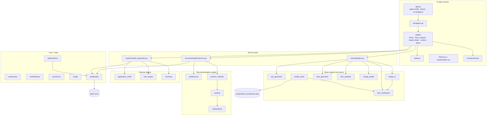
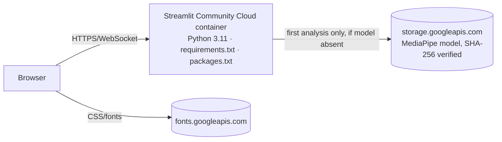

# Architecture — The Beauty Studio

## 1. Component diagram



Supporting modules not drawn above: `src/vision/landmark_indices.py` (MediaPipe index constants), `src/vision/regions.py` (face mask, sampling discs, exclusion masks, sRGB→Lab — shared by quality and skin analysis), `src/ui/resources.py` (process-wide `st.cache_resource` for the immutable catalog, validated rules and the thread-safe detector), `src/ui/navigation.py` (page registry; Home is the default page served at `/`; before the visitor enters, `app.py` registers the pages with a hidden menu and renders `src/ui/pages/welcome.py` instead, whose button calls `st.switch_page` to Home) and `src/logging_config.py`.

## 2. Module dependency rules

- `config` is standalone; `core` depends on nothing else project-internal.
- `data` → `core`, `config`. The loader only parses/schema-validates; semantic rule validation (contradictions, ordering cycles) lives in `routine.rule_engine.load_validated_rules`, keeping `data` free of upward dependencies.
- `vision` → `core`, `config`. `vision` never imports `data`, `recommendation`, `routine` or `ui`.
- `recommendation` → `core`, `data`, `config`.
- `routine` → `core`, `data`, `config`.
- `ui` → everything above. **Nothing imports `ui`** except `app.py`.
- Only `src/ui` and `app.py` import `streamlit`. These rules are enforced by `tests/test_architecture.py`.

## 3. Data flow

```mermaid
sequenceDiagram
  participant U as User
  participant P as Face Analysis page
  participant S as state.py
  participant V as vision.pipeline
  participant R as recommendation.service
  participant G as routine_generator
  U->>P: upload / capture bytes
  P->>S: note_image(fingerprint) — clears analysis if fingerprint changed
  U->>P: Analyze
  P->>V: analyze_image(bytes, detector)
  V-->>P: AnalysisResult | typed error
  P->>S: set_analysis(result) → profile(source=analysis)
  U->>P: confirm / correct features
  P->>S: confirm_features(...)
  U->>R: Shade Finder: category + preferences
  R-->>U: RecommendationResult (computed on every render; never cached → never stale)
  U->>G: Routine: inventory + look + preferences (+ usable features)
  G-->>S: Routine with signature
  S-->>U: shown only while signature matches current inputs
```

## 4. UI-to-service boundaries

Pages translate widget values into typed request objects (`RecommendationPreferences`, `RoutineRequest`, `InventoryItem`) and render typed results. Pages contain no image maths, scoring, ordering or validation logic beyond calling `create_custom_item` etc. All user-visible strings coming from data or users pass through `html.escape` in `components.py`.

## 5. Vision engine interfaces

```python
load_image(data: bytes) -> DecodedImage
class LandmarkDetector(Protocol):
    def detect(self, rgb: np.ndarray) -> list[FaceLandmarks]: ...
validate_landmarks(lm: FaceLandmarks, required: Iterable[int]) -> None
assess_quality(rgb, lm) -> QualityReport
analyze_skin(rgb, lm, quality) -> SkinAnalysis
estimate_face_shape(lm, reliable: bool) -> FeatureEstimate
estimate_eyes(lm, reliable: bool) -> tuple[FeatureEstimate, FeatureEstimate]
analyze_image(data: bytes, detector: LandmarkDetector) -> AnalysisResult
```
`MediaPipeFaceLandmarker` is created once per process (`st.cache_resource`) and guards `detect` with a `threading.Lock`, because Streamlit serves sessions from multiple threads.

## 6. Recommendation engine interfaces

```python
iter_candidates(catalog, category) -> list[Candidate]
apply_hard_filters(category, candidates, profile, prefs) -> FilterOutcome(passed, rejected: Counter[reason])
score_candidate(category, candidate, profile, prefs) -> tuple[ScoreComponent, ...]
rank_candidates(...) -> list[RankedCandidate]          # sorted by (-score, product_id, shade_id)
build_explanation(category, ranked, profile, prefs) -> tuple[str, ...]
recommend(category, profile, prefs, catalog, limit=6) -> RecommendationResult
```

## 7. Routine engine interfaces

```python
create_custom_item(...) -> InventoryItem      # validates; raises RoutineError(invalid_item)
item_from_catalog(product, shade | None) -> InventoryItem
add_item / update_item / remove_item(inventory: tuple, ...) -> tuple   # pure
select_rules(step, item, context, rules) -> SelectedRules             # rule_engine
validate_rules(tutorial_rules) -> None                                # duplicates, refs, contradictions
active_constraints(constraints, context) -> list[OrderingConstraint]
order_steps(present, all_steps, constraints, sequence) -> list[str]   # transitive closure + Kahn
generate_routine(request: RoutineRequest, rules: TutorialRules) -> Routine
```

## 8. Data validation and loading

`data/loader.py` reads the three JSON files with UTF-8, passes raw dicts to `data/schema.py`, which collects every issue (field path + message) and raises a single `CatalogError` listing them. Valid data becomes frozen dataclasses held in a `Catalog` / `TutorialRules` object, cached per process via `st.cache_resource` (immutable, so sharing across sessions is safe). `scripts/validate_data.py` runs the same validation from the command line.

## 9. Session-state management

`src/ui/state.py` owns all keys:

| Key | Type | Lifecycle |
|---|---|---|
| `bs_analysis` | `AnalysisResult \| None` | Set on successful analysis; cleared when a *different* image is selected or the user chooses "Start over". An empty widget alone does not clear it, because Streamlit drops widget values on page navigation. |
| `bs_analysis_error` | `dict \| None` | Error for a specific image fingerprint; shown only while that image is selected |
| `bs_image_fp` | `str \| None` | Fingerprint of the image currently in the widget |
| `bs_profile` | `UserProfile` | From analysis or manual entry; reset when its source analysis is cleared |
| `bs_inventory` | `tuple[InventoryItem, ...]` | Per session; never global |
| `bs_routine` | `Routine \| None` | Shown only if `routine.signature == current_signature(...)` |
| `bs_uploader_nonce` | `int` | Incremented to reset upload/camera widgets |
| `bs_entered` | `bool` | `False` until the welcome screen's button is pressed; then the normal navigation is shown for the rest of the session |

`confirm_features` turns chosen values into `user_confirmed`; choosing "Not set" clears a usable value but leaves an untouched uncertain estimate (and its candidates) intact. Transition functions (`note_image`, `set_analysis`, `set_analysis_error`, `clear_analysis`, `confirm_features`, `store_routine`, `current_routine`, `routine_is_stale`) accept any `MutableMapping`, so they are unit-tested without Streamlit.

## 10. Deployment architecture


One process serves all sessions; per-user state lives in each session's `st.session_state`. Alternative targets (Docker, VM) are described in `DEPLOYMENT.md`.

## 11. Error propagation and logging

Services raise `BeautyStudioError` subclasses with `code` and `user_message`. Pages catch them at the boundary and render `components.error_card`. Unexpected exceptions are caught at the page boundary, logged with `logger.exception` (message and stack only), and shown as a generic failure. Logs record timings, counts and error codes — **never** image bytes, pixel values, landmarks or filenames.

## 12. Privacy boundaries and image lifecycle

```mermaid
flowchart LR
  A[Upload / camera bytes<br/>(Streamlit widget memory)] --> B[load_image: in-memory decode]
  B --> C[Analysis in memory]
  C --> D[AnalysisResult: numbers, statuses, small overlay JPEG]
  D --> E[(session_state — cleared on reset / new image / session end)]
  B -. never .-> X[(disk / logs / network)]
```
Original bytes remain only inside Streamlit's widget state until the user clears the photo (the "Clear photo" action bumps the widget key) or the session ends. No image is written to disk, logged or transmitted to any third party.
